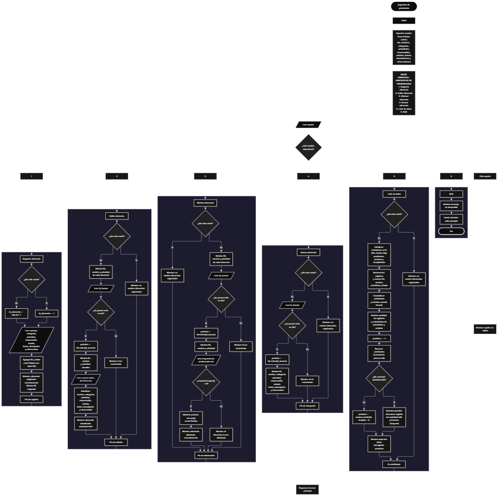

Este proyecto, llamado <b>asignador de prioridades</b>, fue desarrollado en <b>python</b> como un ejercicio práctico para fortalecer la lógica de programación mediante la creación de un sistema de gestión de elementos desde la consola. El programa cuenta con un menú principal de seis opciones que permite <b>registrar, editar, eliminar, buscar y listar elementos, además de salir del sistema</b>. Cada elemento almacena información como el nombre, la categoría, la prioridad, el responsable, el estado, la fecha de registro, la descripción y la observación. Los datos se organizan mediante nueve listas paralelas que permiten relacionar cada registro con su identificador. Durante su desarrollo se aplicaron conceptos fundamentales de programación, como variables, listas, estructuras condicionales, ciclos repetitivos, estructuras de selección, contadores y métodos para administrar registros. Además, el sistema calcula estadísticas de prioridades y estados, identifica el primer elemento con prioridad alta y, si no existe ninguno, selecciona un registro aleatorio. Este proyecto permite poner en práctica los conocimientos adquiridos en Python y sirve como base para desarrollar sistemas de gestión más avanzados utilizando otros lenguajes y tecnologías.

<h2 align="center">⚙️ Funcionamiento del menú principal</h2>

### ➕ Registrar elemento

La opción <b>1) registrar elemento</b> permite incorporar un nuevo registro al sistema. Antes de almacenar los datos, el programa comprueba si la lista <b>ids</b> está vacía mediante la condición <b>len(ids) == 0</b>. Si no existen registros, asigna el identificador <b>1</b> a la variable <b>id_elemento</b>. En caso contrario, genera el siguiente identificador utilizando la expresión <b>ids[-1] + 1</b>, que toma el último ID almacenado y le suma uno. Después, solicita el <b>nombre, la categoría, la prioridad, el responsable, el estado, la fecha de registro, la descripción y la observación</b> del elemento. Finalmente, utiliza el método <b>append()</b> para agregar el identificador y los ocho datos a sus respectivas listas, muestra el mensaje <b>"elemento registrado correctamente."</b> e informa el ID asignado. Las prioridades sugeridas son alta, media o baja, mientras que los estados sugeridos son pendiente, en proceso o completado; sin embargo, el programa no comprueba que los valores introducidos pertenezcan a esas opciones.

### ✏️ Editar elemento

La opción <b>2) editar elemento</b> permite modificar los datos de un registro existente. Primero, el programa comprueba si la lista <b>ids</b> está vacía. Si no existen elementos, muestra el mensaje <b>"no existen elementos registrados."</b>. En caso contrario, presenta una lista con el identificador, el nombre y la prioridad de cada registro mediante un ciclo <b>for</b>. Después, solicita el ID del elemento que se desea editar y comprueba si está presente en la lista <b>ids</b>. Si el identificador existe, utiliza <b>ids.index(id_buscar)</b> para obtener la posición correspondiente y muestra el ID, el nombre y la prioridad actuales. A continuación, solicita los nuevos valores para el <b>nombre, la categoría, la prioridad, el responsable, el estado, la fecha, la descripción y la observación</b>, actualizando directamente las listas correspondientes. El identificador se conserva porque no se modifica durante esta operación. Finalmente, muestra el mensaje <b>"elemento actualizado correctamente."</b>. Si el ID no está registrado, presenta el mensaje <b>"id no encontrada."</b>.

### 🗑️ Eliminar elemento

La opción <b>3) eliminar elemento</b> permite eliminar un registro mediante su identificador. Primero, el programa comprueba si existen elementos almacenados. Si la lista <b>ids</b> está vacía, muestra el mensaje <b>"no existen elementos registrados."</b>. Si existen registros, presenta una lista con el ID, el nombre y la prioridad de cada elemento. Después, solicita el identificador que se desea eliminar y comprueba si se encuentra en la lista <b>ids</b>. Cuando lo encuentra, obtiene su posición mediante <b>ids.index(id_buscar)</b> y muestra el ID, el nombre y la prioridad del elemento seleccionado. A continuación, solicita confirmación mediante la pregunta <b>"¿desea eliminar este elemento? (s/n): "</b>. Si la respuesta, convertida a mayúsculas mediante <b>upper()</b>, es igual a <b>"S"</b>, el programa utiliza <b>pop(posicion)</b> para eliminar la misma posición de las nueve listas, manteniendo sincronizados los datos. Finalmente, muestra el mensaje <b>"elemento eliminado correctamente."</b>. Si el usuario no confirma la eliminación, muestra <b>"el elemento no fue eliminado."</b>. Si el ID no existe, informa que no se encontró.

### 🔎 Buscar elemento

La opción <b>4) buscar elemento</b> permite localizar un registro mediante su identificador. Primero, el programa comprueba si existen elementos registrados utilizando la condición <b>len(ids) == 0</b>. Si la lista está vacía, muestra el mensaje <b>"no existen elementos registrados."</b>. En caso contrario, solicita el ID que se desea buscar y comprueba si está presente en <b>ids</b>. Si lo encuentra, utiliza <b>ids.index(id_buscar)</b> para obtener la posición del registro y muestra toda su información: <b>ID, nombre, categoría, prioridad, responsable, estado, fecha, descripción y observación</b>. Si el identificador no se encuentra en la lista, presenta el mensaje <b>"id no encontrada."</b>. Esta operación permite consultar los datos completos de un elemento sin necesidad de recorrer visualmente todos los registros.

### 📋 Lista de datos

La opción <b>5) lista de datos</b> permite visualizar los elementos registrados y obtener estadísticas generales del sistema. Primero, comprueba si la lista <b>ids</b> está vacía. Si no existen elementos, muestra el mensaje <b>"no existen elementos registrados."</b>. Si hay registros disponibles, inicializa los contadores <b>alta, media, baja, pendientes, proceso y completados</b> en cero. Después, utiliza un ciclo <b>for</b> para recorrer las listas y mostrar el ID, el nombre, la prioridad y el estado de cada elemento. Durante el recorrido, compara las prioridades y los estados utilizando el método <b>lower()</b>, que permite reconocer los valores esperados independientemente del uso de mayúsculas y minúsculas. Cada coincidencia incrementa el contador correspondiente. Al terminar, muestra la cantidad total de registros, las cantidades de prioridades altas, medias y bajas, y las cantidades de elementos pendientes, en proceso y completados. Posteriormente, busca el primer elemento cuya prioridad sea <b>"alta"</b>. Si encuentra uno, guarda su posición y detiene el recorrido mediante <b>break</b>. Si no encuentra ninguno, selecciona una posición aleatoria utilizando <b>random.randint(0, len(ids) - 1)</b>. Finalmente, muestra todos los datos del registro seleccionado bajo el título <b>"registro prioritario"</b>. Por lo tanto, cuando existen elementos de prioridad alta, se muestra el primero que aparece en la lista; cuando no existen, se muestra un registro aleatorio.

### 🚪 Salir del menú principal

La opción <b>6) salir</b> permite finalizar la ejecución del programa. Cuando el usuario selecciona esta opción, el sistema muestra el mensaje <b>"gracias por utilizar el asignador de prioridades."</b> y ejecuta la instrucción <b>break</b>, que termina el ciclo principal <b>while True</b>. De esta manera, el programa deja de mostrar el menú y finaliza su ejecución. Si el usuario introduce un valor que no coincide con las opciones disponibles, el bloque <b>else</b> muestra el mensaje <b>"opción no válida."</b> y el menú vuelve a presentarse porque el ciclo continúa activo.

<h2 align="center">🧠 Temas aplicados en el proyecto</h2>

### 📦 Variables

En este proyecto se utilizan variables para almacenar temporalmente la opción seleccionada en el menú, los datos introducidos durante el registro o la edición, el identificador que se desea buscar, la posición de un elemento y los contadores empleados para calcular las estadísticas. También se utilizan variables para controlar la búsqueda del primer elemento con prioridad alta y determinar cuándo es necesario seleccionar un registro aleatorio. Cada variable cumple una función específica dentro de las operaciones de administración de elementos.

🔢 **Opcion:** Almacena la opción seleccionada por el usuario en el menú principal.

🆔 **Id_elemento:** Almacena el identificador asignado al registrar un nuevo elemento.

🔎 **Id_buscar:** Almacena el identificador introducido para localizar un registro.

📍 **Posicion:** Representa el índice del elemento encontrado o seleccionado dentro de las listas.

🔄 **I:** Funciona como contador en los ciclos `for` utilizados para recorrer los registros.

📊 **Alta, media y baja:** Almacenan las cantidades de elementos correspondientes a cada nivel de prioridad.

📋 **Pendientes, proceso y completados:** Almacenan las cantidades de elementos según su estado.

### 🗃️ Listas

En este proyecto se utilizan nueve listas paralelas para almacenar la información de los elementos registrados. Cada lista conserva un tipo de dato y todas se relacionan mediante el mismo índice. Por ejemplo, los datos de un elemento situado en la posición <b>0</b> se encuentran distribuidos entre <b>ids[0], nombres[0], categorias[0], prioridades[0], responsables[0], estados[0], fechas[0], descripciones[0] y observaciones[0]</b>. Esta organización permite registrar, consultar, modificar y eliminar elementos manteniendo la correspondencia entre sus datos. Las listas se crean vacías al iniciar el programa y no tienen una capacidad máxima definida explícitamente.

🆔 **Ids:** Almacena los identificadores numéricos de los elementos.

📝 **Nombres:** Almacena los nombres de los elementos registrados.

🗂️ **Categorias:** Almacena las categorías de los elementos.

🚦 **Prioridades:** Almacena los niveles de prioridad alta, media o baja introducidos por el usuario.

👤 **Responsables:** Almacena los nombres o datos de los responsables.

📌 **Estados:** Almacena los estados de los elementos.

📅 **Fechas:** Almacena las fechas de registro.

📄 **Descripciones:** Almacena las descripciones de los elementos.

💬 **Observaciones:** Almacena las observaciones asociadas a cada registro.

### 🔀 Estructuras condicionales

En este proyecto se utilizan las estructuras condicionales <b>if, elif y else</b> para controlar las opciones del menú y determinar qué operación debe ejecutarse. También permiten comprobar si existen registros antes de realizar una búsqueda, edición, eliminación o listado; verificar si el ID introducido pertenece a un elemento registrado; confirmar la eliminación; clasificar los registros por prioridad y estado; y decidir qué elemento se mostrará como prioritario. Estas condiciones permiten que el programa responda de manera diferente según la información almacenada y las decisiones del usuario.

### 🔄 Estructuras repetitivas

En este proyecto se utilizan los ciclos <b>while</b> y <b>for</b>. El ciclo <b>while True</b> mantiene activo el menú principal y permite ejecutar diferentes operaciones hasta que el usuario selecciona la opción de salida, que utiliza <b>break</b> para finalizarlo. Los ciclos <b>for</b> recorren las listas para mostrar los elementos disponibles, calcular las estadísticas y buscar el primer registro con prioridad alta. En este último recorrido, la instrucción <b>break</b> interrumpe la búsqueda cuando encuentra la primera coincidencia. Estas estructuras permiten automatizar tareas repetitivas y procesar los registros almacenados.

### 🎯 Estructura de selección

El programa utiliza una cadena de condiciones <b>if, elif y else</b> para evaluar el valor almacenado en la variable <b>opcion</b> y ejecutar la operación correspondiente. Cada alternativa representa una función específica del sistema: <b>registrar, editar, eliminar, buscar, listar datos o salir</b>. El bloque <b>else</b> funciona como alternativa cuando el valor introducido no coincide con ninguna de las opciones disponibles y muestra el mensaje <b>"opción no válida."</b>. Esta estructura organiza el funcionamiento del menú principal y facilita el acceso a las distintas operaciones.

### 🔢 Generación de identificadores

El programa asigna un identificador numérico a cada elemento registrado. Cuando no existen registros, la variable <b>id_elemento</b> recibe el valor <b>1</b>. Cuando ya hay elementos, se utiliza la expresión <b>ids[-1] + 1</b>, que obtiene el último identificador almacenado y suma uno para generar el siguiente. Este procedimiento permite distinguir los registros durante las operaciones de búsqueda, edición y eliminación. Sin embargo, el identificador se calcula a partir del último elemento de la lista y no del valor máximo de todos los identificadores existentes. Por ello, si se elimina el último registro, un identificador previamente utilizado podría volver a asignarse.

### 🔍 Búsqueda de registros

El programa utiliza el operador <b>in</b> para comprobar si un identificador se encuentra en la lista <b>ids</b> y el método <b>index()</b> para obtener su posición. Por ejemplo, la condición <b>id_buscar in ids</b> permite determinar si el elemento existe, mientras que <b>ids.index(id_buscar)</b> devuelve el índice que corresponde al identificador. La posición obtenida se utiliza después para consultar o modificar los datos de las demás listas. En la opción de estadísticas, también se realiza una búsqueda secuencial mediante un ciclo <b>for</b> para identificar el primer elemento con prioridad alta.

### 📊 Estadísticas y selección prioritaria

La opción de listado utiliza contadores para clasificar los registros según sus prioridades y estados. Las variables <b>alta, media y baja</b> registran las cantidades de elementos correspondientes a cada nivel de prioridad. Las variables <b>pendientes, proceso y completados</b> contabilizan los registros que coinciden con los estados esperados. Para comparar los textos, se utiliza <b>lower()</b>, lo que permite reconocer, por ejemplo, <b>"ALTA"</b> y <b>"alta"</b> como valores equivalentes. Después, el programa busca el primer registro de prioridad alta. Si no encuentra ninguno, utiliza el módulo <b>random</b> para elegir una posición aleatoria entre los índices disponibles. Esta operación permite destacar un registro sin modificar su prioridad ni su estado.

<h2 align="center">¿Cómo se implementaron las operaciones crud en el proyecto?</h2>

Las operaciones <b>crud</b> se implementaron mediante las opciones del menú principal para administrar los elementos registrados. La operación <b>crear</b> corresponde a <b>registrar elemento</b>, donde se solicitan los datos y se incorporan a las listas mediante <b>append()</b>. La operación <b>leer</b> se realiza mediante <b>buscar elemento</b> y <b>lista de datos</b>, que permiten consultar la información individual y visualizar los registros junto con sus estadísticas. La operación <b>actualizar</b> corresponde a <b>editar elemento</b>, donde se modifican los datos de un registro existente mediante su identificador. Finalmente, la operación <b>eliminar</b> se realiza mediante <b>eliminar elemento</b>, que solicita confirmación y utiliza <b>pop()</b> para retirar los datos correspondientes de las nueve listas. Estas operaciones utilizan variables, listas, condiciones y ciclos para gestionar la información almacenada temporalmente durante la ejecución del programa.

<h2 align="center">Diagrama de flujo del proyecto</h2>

<h2 align="center">🛡️ Validaciones del programa</h2>

### 📭 No existen elementos registrados

Esta comprobación se utiliza en las opciones de <b>editar, eliminar, buscar y lista de datos</b>. El programa evalúa la condición <b>len(ids) == 0</b> para determinar si la lista de identificadores está vacía. Si no existen registros, muestra el mensaje <b>"no existen elementos registrados."</b> y evita continuar con la operación que requiere información almacenada. Esta comprobación permite gestionar correctamente los casos en los que el usuario intenta consultar o administrar una lista vacía.

### ❌ Identificador no encontrado

Esta comprobación se utiliza en las opciones de <b>editar, eliminar y buscar elemento</b>. Después de solicitar el identificador, el programa comprueba si está presente en la lista <b>ids</b>. Si existe, obtiene la posición mediante <b>index()</b> y continúa con la operación correspondiente. Si no se encuentra, muestra el mensaje <b>"id no encontrada."</b>. Esta comprobación evita que el programa intente consultar, modificar o eliminar un elemento utilizando un identificador que no está almacenado.

### 🗑️ Confirmación de eliminación

Antes de eliminar un elemento, el programa solicita confirmación mediante la pregunta <b>"¿desea eliminar este elemento? (s/n): "</b>. La respuesta se convierte a mayúsculas mediante <b>upper()</b> y se compara con el valor <b>"S"</b>. Si coincide, el sistema elimina los datos de la posición correspondiente en las nueve listas. Si la respuesta es diferente, muestra el mensaje <b>"el elemento no fue eliminado."</b>. Esta comprobación permite que el usuario confirme la eliminación antes de retirar el registro.

### 🚦 Clasificación por prioridad y estado

Durante la opción <b>5) lista de datos</b>, el programa utiliza condiciones para clasificar las prioridades y los estados. Las prioridades se contabilizan cuando coinciden con <b>"alta"</b>, <b>"media"</b> o <b>"baja"</b>, mientras que los estados se contabilizan cuando coinciden con <b>"pendiente"</b>, <b>"en proceso"</b> o <b>"completado"</b>. Las comparaciones utilizan <b>lower()</b> para ignorar las diferencias entre mayúsculas y minúsculas. Sin embargo, el programa no valida los valores introducidos durante el registro o la edición. Por ello, si un usuario escribe una prioridad o un estado diferente de los previstos, el registro se almacena, pero ese valor no se suma a ninguno de los contadores definidos.

### 🎯 Selección del registro prioritario

Esta operación se ejecuta al finalizar las estadísticas de la opción <b>5) lista de datos</b>. El programa inicializa la variable <b>posicion</b> con el valor <b>-1</b> y recorre las prioridades almacenadas para buscar la primera que coincida con <b>"alta"</b>. Si encuentra una coincidencia, guarda su posición y detiene el ciclo mediante <b>break</b>. Si no encuentra ninguna prioridad alta, selecciona una posición aleatoria mediante <b>random.randint(0, len(ids) - 1)</b>. Como esta operación solo se ejecuta cuando existen registros, el rango de selección dispone de posiciones válidas. El procedimiento no cambia los datos almacenados: únicamente determina cuál de los registros se mostrará como prioritario.

### ⚠️ Opción no válida

El menú principal utiliza una estructura condicional que evalúa las opciones del <b>1</b> al <b>6</b>. Si el usuario introduce un valor diferente, el bloque <b>else</b> muestra el mensaje <b>"opción no válida."</b>. Después, el ciclo <b>while True</b> continúa y vuelve a presentar el menú principal. Esta alternativa permite informar al usuario cuando la opción introducida no coincide con ninguna de las operaciones disponibles.

### 🔢 Entrada numérica del identificador

En las operaciones de edición, eliminación y búsqueda, el programa utiliza <b>int(input("ingrese la id del elemento: "))</b> para convertir el identificador introducido en un número entero. Esta conversión permite compararlo con los valores almacenados en la lista <b>ids</b>. Sin embargo, no existe un manejo de excepciones para controlar entradas que no sean numéricas. Si el usuario introduce letras u otro contenido que no pueda convertirse a entero, se producirá un error y el programa podrá finalizar inesperadamente. Por tanto, el código actual realiza la conversión numérica, pero no incluye una validación que permita recuperarse de entradas incorrectas.

<h2 align="center">🎯 Objetivo del proyecto</h2>

El objetivo principal de este proyecto es fortalecer la <b>lógica de programación</b> mediante el desarrollo de un sistema de gestión de elementos con prioridades en <b>python</b>. A través de su construcción se busca aplicar los conocimientos adquiridos sobre variables, listas, estructuras condicionales, ciclos repetitivos, estructuras de selección, métodos de listas y generación de valores aleatorios. Además, el proyecto permite comprender cómo registrar, consultar, modificar y eliminar información, calcular estadísticas y seleccionar registros según criterios definidos. De esta manera, se establece una base para desarrollar sistemas de gestión más completos que permitan organizar tareas, controlar estados y administrar información de manera estructurada.

